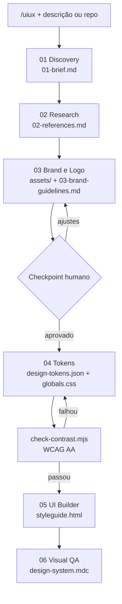

# UI/UX-Factory

Fábrica de identidade visual e design system para o [Cursor](https://cursor.com). A partir de uma ideia ou de um repositório existente, um orquestrador conduz seis agentes especializados que pesquisam referências, desenham a marca, geram logos, definem tokens acessíveis, montam um styleguide navegável e entregam uma regra pronta para os agentes de frontend seguirem.

O resultado não é um mockup solto. É um pacote versionável: briefing, benchmark, guidelines, assets, tokens em JSON e CSS, preview HTML e um arquivo `.mdc` que trava as decisões visuais no projeto que vai consumi-las.

## O que você recebe

| Entrega | Para que serve |
| --- | --- |
| Briefing de produto | Fixa persona, personalidade, direção estética e o que a interface não pode parecer |
| Benchmark com duas direções | Fundamenta a escolha visual em produtos reais, com uma recomendação explícita |
| Três conceitos de logo + SVG | Marca raster (gerada) e versões vetoriais para claro, escuro e favicon |
| Guidelines de marca | Uso, área de respiro, tamanho mínimo e proibições |
| Design tokens | Escalas de cor, tipo, raio, sombra, espaço e movimento, em Light e Dark |
| Laudo de contraste WCAG AA | Nenhum par texto/fundo abaixo de 4.5:1 passa para a etapa seguinte |
| Styleguide HTML | Prova o sistema em componentes com estado e em dois layouts de exemplo |
| Regra `design-system.mdc` | Contrato que agentes de código devem obedecer ao implementar a UI |

Há um ponto de parada obrigatório depois da logo. O pipeline não desenha tokens nem componentes até você aprovar o conceito.

## Como funciona

O comando `/uiux` coloca o agente no papel de orquestrador. Ele lê, na ordem, os prompts em `~/.cursor/agents/` e grava cada artefato em `<OUTPUT_DIR>` antes de chamar o próximo. Esses arquivos são a memória compartilhada: nenhum agente inventa um valor que o anterior não tenha deixado em disco.



Regras que o orquestrador não negocia:

- Nenhuma etapa é pulada, e nenhum valor visual existe só no chat. Se não foi salvo no artefato da etapa, não entra na próxima.
- Componentes não carregam cor hardcoded. Tudo aponta para as variáveis CSS dos tokens.
- A geometria da logo manda na UI. Cantos retos ou arredondados, e a espessura do traço, reaparecem em `border-radius`, ícones e botões.

## Os seis agentes

Cada arquivo em `.cursor/agents/` é um subagente com missão, entradas e saída obrigatória. O modelo é `inherit`: eles rodam no mesmo modelo da conversa em que você disparou `/uiux`.

### 01 — Discovery

Entende o produto antes de qualquer decisão visual.

- Se o workspace já é um projeto (`package.json`, `README`, rotas, `src/` ou `app/`), lê a stack, o domínio, o público e as funcionalidades.
- Se o workspace está vazio, faz no máximo seis perguntas: nome da marca, nicho, público, três adjetivos de personalidade, preferência light/dark e referências que você gosta ou rejeita.
- Fecha o briefing com uma restrição estética forte, para o resultado não cair em visual genérico de template. Exemplos do próprio prompt: editorial minimalista, dashboard técnico de alta densidade, brutalismo limpo.

Saída: `<OUTPUT_DIR>/docs/01-brief.md`, com resumo do produto, stack alvo, persona, três pilares de personalidade, direção estética e anti-padrões.

### 02 — Research

Lê o briefing e busca na web de três a cinco produtos do mesmo nicho ou da mesma estética. Olha hierarquia tipográfica, densidade, cor de destaque, navegação e micro-interações. Entrega duas direções distintas (uma mais contida, outra mais ousada) e recomenda uma delas.

Saída: `<OUTPUT_DIR>/docs/02-references.md`.

### 03 — Brand e Logo

Define símbolo, metáfora visual e uma paleta mínima: uma primária, uma neutra e uma de destaque. Gera três conceitos raster com `scripts/generate-logo.mjs` (Pollinations, modelo Flux, sem chave de API) e, em seguida, versões vetoriais escritas à mão:

- `logo-light.svg` para fundo claro
- `logo-dark.svg` para fundo escuro
- `favicon.svg` simplificado, pensado para 32×32

O guia de marca registra regras de uso, área de respiro, tamanho mínimo e o que não fazer com a marca.

Saída: imagens e SVGs em `<OUTPUT_DIR>/assets/`, mais `<OUTPUT_DIR>/docs/03-brand-guidelines.md`.

**Aqui o pipeline para.** O orquestrador mostra os arquivos e o conceito e só chama o agente 04 depois da sua aprovação. Se quiser outra direção, o ajuste acontece nesta etapa, antes de qualquer token ser derivado da logo errada.

### 04 — Design Tokens

Extrai os hexadecimais da logo aprovada e monta o sistema formal.

- Escalas 50–950 para Primary, Neutral e Accent, mais semânticas de Success, Warning, Danger e Info.
- Pares de tema para claro e escuro: canvas, surface, texto primário e secundário, borda, marca e hover.
- Três famílias gratuitas do Google Fonts (display, body e mono) e uma escala de `xs` a `5xl`.
- Raio, sombra, espaçamento e transição coerentes com a geometria da logo.

A validação é obrigatória. O JSON precisa trazer o array `contrastChecks`, e o script `check-contrast.mjs` roda até todos os pares de texto sobre fundo passarem em WCAG AA (4.5:1 por padrão). Token que falha é reescrito e testado de novo.

Saída:

- `<OUTPUT_DIR>/tokens/design-tokens.json` no formato de design tokens do W3C, com `contrastChecks`
- `<OUTPUT_DIR>/tokens/globals.css` com variáveis em `:root` e em `[data-theme="dark"]`

### 05 — UI Builder

Monta um styleguide em HTML e CSS puro (ou Tailwind via CDN) que importa `../tokens/globals.css`. Abrir o arquivo no navegador já basta; não há build.

O preview inclui:

1. Toggle funcional de Light e Dark no topo.
2. `logo-light.svg`, `logo-dark.svg` e `favicon.svg` sobre fundos contrastantes.
3. Amostras da paleta, escala tipográfica e escala de sombra e borda.
4. Componentes com `hover`, `focus`, `active` e `disabled`: botões (`primary`, `secondary`, `outline`, `ghost`, `destructive`, `loading`), inputs, selects, checkboxes, toggles, erro de formulário, cards, badges, alerts e tabela.
5. Um bloco de hero/landing e um mini-layout de dashboard, ambos usando só os tokens.

Saída: `<OUTPUT_DIR>/preview/styleguide.html`.

### 06 — Visual QA e handoff

Abre o styleguide, confere alinhamento, legibilidade, hierarquia, espaçamento e se a logo e os componentes parecem do mesmo sistema. Defeito encontrado é corrigido em `globals.css` ou no HTML, não só anotado.

Se o Playwright MCP estiver ativo, captura desktop (1440px) e mobile (375px), em Light e em Dark. Sem o MCP, a etapa segue com inspeção visual disponível na sessão.

A entrega final é a regra de integração:

- `<OUTPUT_DIR>/cursor-rule/design-system.mdc`
- No modo brownfield, também `.cursor/rules/design-system.mdc` na raiz do projeto que você está editando

Esse `.mdc` resume a identidade, aponta tokens e assets, e impõe aos agentes de frontend a proibição de cor hardcoded e os padrões de botão, tipo, borda e animação.

## Modos de execução

O orquestrador escolhe `<OUTPUT_DIR>` antes do passo 1. Qualquer menção a `design-system/` dentro dos prompts dos subagentes é reescrita para esse diretório.

| Modo | Quando | Onde os arquivos caem |
| --- | --- | --- |
| Greenfield | Pasta vazia, ou você passou só a ideia | `projects/<slug-do-projeto>/`. O comando `/uiux` também aceita `design-system-<slug>/` |
| Brownfield | O workspace já é um software (`package.json`, `composer.json`, `src/`, rotas) | `design-system/` na raiz do projeto, pelo comando `/uiux`. A regra deste repositório prefere `projects/<slug>/`, e usa `design-system/` dentro do repo alvo quando você pede isso |

No brownfield o discovery lê o código em vez de entrevistar. No fim, a regra `design-system.mdc` é copiada para `.cursor/rules/` do projeto, para o próximo agente que implementar tela já nascer obedecendo a marca.

Pastas `projects/` e `design-system/` estão no `.gitignore` de propósito: são saída de teste local, não fonte deste repositório.

## Pré-requisitos

- [Cursor](https://cursor.com) com suporte a comandos em `~/.cursor/commands/` e subagentes em `~/.cursor/agents/`.
- Node.js 18 ou superior. Os scripts são ESM (`.mjs`), usam `fetch` nativo e top-level await, e não têm `package.json` nem dependências para instalar.
- Rede liberada na hora de gerar logo. O script chama a API pública da [Pollinations](https://pollinations.ai) (modelo Flux). Não há chave, cadastro nem cota configurada neste repo; a disponibilidade é a do serviço.
- Busca web na sessão do Cursor, para o agente de research.
- Playwright MCP, opcional. Sem ele o QA visual ainda produz o `.mdc`; deixam de existir as capturas automáticas em 1440px e 375px.

## Instalação

O instalador não copia a fábrica para dentro de cada projeto. Ele cria links em `~/.cursor/`, então um único clone serve para qualquer workspace. No Linux e no macOS os links são simbólicos: editar este repositório atualiza o que o Cursor executa. No Windows, o script tenta symlink e, se não houver permissão, copia o arquivo; a pasta de scripts entra como junction.

### Linux e macOS

```bash
git clone https://github.com/<org>/ui-ux-factory.git
cd ui-ux-factory
bash install.sh
```

O script cria `~/.cursor/agents/`, `~/.cursor/commands/` e `~/.cursor/ui-ux-factory/`, aponta cada `*.md` de agentes e de comandos para este clone, e liga `scripts/` em `~/.cursor/ui-ux-factory/scripts`.

### Windows (PowerShell)

```powershell
git clone https://github.com/<org>/ui-ux-factory.git
cd ui-ux-factory
powershell -ExecutionPolicy Bypass -File .\install.ps1
```

### Depois de instalar

Reinicie o Cursor, ou recarregue a janela. O comando `/uiux` passa a aparecer no chat de qualquer projeto.

Para atualizar, faça `git pull` neste clone. Em Unix não é preciso rodar o instalador de novo. No Windows, rode `install.ps1` outra vez se a instalação anterior tiver caído no fallback de cópia.

## Uso

No chat de um projeto novo ou de um repositório existente:

```text
/uiux
```

O texto que vier depois do comando entra no discovery. Quanto mais concreto, menos o agente precisa perguntar.

Greenfield, só a ideia:

```text
/uiux Marca chamada Norte, app de planejamento financeiro para autônomos no Brasil.
Público de 25 a 40 anos. Personalidade: direta, calma, precisa.
Tema escuro. Gosto de Linear e odeio dashboard roxo com gradiente.
```

Brownfield, em cima de um código que já existe:

```text
/uiux Este repositório é o produto. Extraia a stack e as telas atuais
e monte o design system em ./design-system sem reinventar o domínio.
```

O que acontece em seguida:

1. O discovery grava o briefing. Se faltar dado essencial e não houver código para ler, ele pergunta. Responda no mesmo chat.
2. Research e brand seguem sozinhos até as três logos e o guia.
3. O agente para e mostra os conceitos. Aprove, ou peça variação (símbolo, peso do traço, cor, metáfora). Só então os tokens são derivados.
4. O architect gera os tokens e roda o contraste. Falha de WCAG volta para ajuste automático até passar.
5. O styleguide é escrito e aberto. O QA confere e, se preciso, corrige CSS e HTML.
6. Você fica com `cursor-rule/design-system.mdc` (e, no brownfield, com a cópia em `.cursor/rules/`).

Abra o preview direto no navegador:

```bash
# ajuste o caminho se o modo escolheu outro diretório
xdg-open design-system/preview/styleguide.html
```

## Árvore de saída

```text
<OUTPUT_DIR>/
├── docs/
│   ├── 01-brief.md                 # produto, persona, direção, anti-padrões
│   ├── 02-references.md            # benchmark e duas direções
│   └── 03-brand-guidelines.md      # conceito, paleta, regras da logo
├── assets/
│   ├── logo-concept-1.png          # conceito raster
│   ├── logo-concept-2.png
│   ├── logo-concept-3.png
│   ├── logo-light.svg              # versão vetorial para fundo claro
│   ├── logo-dark.svg               # variação para fundo escuro
│   └── favicon.svg                 # marca reduzida
├── tokens/
│   ├── design-tokens.json          # W3C + contrastChecks
│   └── globals.css                 # :root e [data-theme="dark"]
├── preview/
│   └── styleguide.html             # prova visual, sem build
└── cursor-rule/
    └── design-system.mdc           # contrato para agentes de frontend
```

## Tokens e contraste

`design-tokens.json` segue o formato de design tokens do W3C e acrescenta um array que o validador entende. Cada item nomeia um par, a cor de frente, a de fundo e, se quiser, um mínimo diferente de 4.5:

```json
{
  "contrastChecks": [
    { "name": "Texto primário / canvas (light)", "fg": "#1A1A1A", "bg": "#FAFAF7" },
    { "name": "Texto sobre marca", "fg": "#FFFFFF", "bg": "#0E6B4F", "min": 4.5 }
  ]
}
```

`scripts/check-contrast.mjs` converte o hex em luminância relativa (a fórmula do WCAG 2, com o limiar 0.03928 e o gama 2.4) e imprime `PASS` ou `FAIL` com a razão `x.xx:1`. Se algum par fica abaixo do mínimo, o processo termina com código 1 e a mensagem pede ajuste. Sem o array, o script só avisa e sai com código 0: por isso o agente 04 é obrigado a gravar `contrastChecks` antes de considerar a etapa concluída.

`globals.css` expõe as mesmas decisões como variáveis CSS. O styleguide e qualquer tela futura devem consumir nomes (`--bg-canvas`, `--text-primary`, `--brand-primary`, `--brand-hover`, `--border-subtle`, `--bg-surface`), nunca o hexadecimal solto.

## Scripts

Os dois utilitários ficam em `scripts/` e, depois da instalação, em `~/.cursor/ui-ux-factory/scripts/`. Dá para rodá-los à mão.

### `generate-logo.mjs`

Gera um PNG 1024×1024 via Pollinations (Flux). O prompt que você passa é sufixado com instruções fixas de logo vetorial, flat, geométrica, centralizada, fundo sólido, alto contraste, sem mockup e sem marca d'água. A seed é aleatória, então duas chamadas com o mesmo texto não produzem o mesmo arquivo.

```bash
node scripts/generate-logo.mjs \
  "flat vector logo, abstract north star, deep green, minimal, solid background, no text" \
  projects/norte/assets/logo-concept-1.png
```

Sem prompt, o script imprime o uso e sai com código 1. O diretório de destino é criado se não existir. Resposta HTTP diferente de 2xx encerra com o status da API.

### `check-contrast.mjs`

```bash
node scripts/check-contrast.mjs projects/norte/tokens/design-tokens.json
```

O caminho é opcional e cai em `design-system/tokens/design-tokens.json` quando omitido. Use isso ao editar tokens manualmente: o mesmo portão que o agente 04 enfrenta vale para alteração humana.

## Estrutura deste repositório

```text
ui-ux-factory/
├── .cursor/
│   ├── agents/                 # prompts dos seis subagentes
│   │   ├── 01-discovery.md
│   │   ├── 02-researcher.md
│   │   ├── 03-brand-logo.md
│   │   ├── 04-token-architect.md
│   │   ├── 05-ui-builder.md
│   │   └── 06-visual-qa.md
│   └── rules/
│       └── orchestrator.mdc    # regra always-apply quando este repo é o workspace
├── commands/
│   └── uiux.md                 # vira o comando /uiux depois do install
├── scripts/
│   ├── generate-logo.mjs
│   └── check-contrast.mjs
├── design-system/              # placeholder local, ignorado pelo git
├── install.sh
├── install.ps1
└── .gitignore
```

Dois arquivos mandam no fluxo, e eles não são idênticos:

- `commands/uiux.md` é o que roda em qualquer projeto depois da instalação. É a fonte operacional do `/uiux`, inclusive dos caminhos `./design-system` (brownfield) e `design-system-<slug>` ou `projects/<slug>` (greenfield).
- `.cursor/rules/orchestrator.mdc` vale quando você está com **este** repositório aberto. A instalação global não copia essa regra; ela só liga agentes, comando e scripts. Aqui o diretório preferido é sempre `projects/<slug>`.

Os prompts dos agentes citam `~/.cursor/ui-ux-factory/scripts/` e `~/.cursor/agents/` porque foram escritos para o layout pós-instalação. Dentro deste clone, os mesmos arquivos estão em `scripts/` e `.cursor/agents/`.

## Personalizar a fábrica

O comportamento mora nos Markdown, não em código de aplicação. Para mudar o pipeline:

| Quero | Arquivo |
| --- | --- |
| Alterar perguntas do briefing, o tom estético ou o formato do brief | `.cursor/agents/01-discovery.md` |
| Mudar quantas referências entram ou como as duas direções são comparadas | `.cursor/agents/02-researcher.md` |
| Trocar o gerador de imagem, o número de conceitos ou os SVGs exigidos | `.cursor/agents/03-brand-logo.md` e, se a API mudar, `scripts/generate-logo.mjs` |
| Incluir token novo, outra fonte ou outro piso de contraste | `.cursor/agents/04-token-architect.md` |
| Acrescentar componente ou layout no preview | `.cursor/agents/05-ui-builder.md` |
| Exigir outro viewport, ou mudar o contrato do `.mdc` | `.cursor/agents/06-visual-qa.md` |
| Mudar a ordem, o diretório de saída ou o texto do checkpoint | `commands/uiux.md` e `.cursor/rules/orchestrator.mdc` |

Mantenha os dois orquestradores alinhados quando mexer em ordem ou em caminho. Um agente só enxerga o que o arquivo da etapa anterior gravou: se mudar um nome de artefato, atualize o `Input` do agente seguinte.

No Unix, com o symlink do `install.sh`, salvar o Markdown já vale para o próximo `/uiux`. Recarregue a janela do Cursor se o comando não refletir a edição.

## Solução de problemas

**`/uiux` não aparece.** Confirme os links: `ls -l ~/.cursor/commands/uiux.md` e `ls ~/.cursor/agents/`. Se apontarem para um clone que foi movido, rode o instalador de novo. Depois recarregue a janela.

**A geração da logo falha com erro de API.** O script imprime `Erro na API: <status>`. É rede ou instabilidade da Pollinations, não um token ausente. Rode o comando de novo; a seed muda a cada chamada. Confira também se o Node é 18+ (`node -v`), porque o script depende de `fetch` global.

**O contraste não fecha.** A saída lista cada par com a razão medida. Suba o contraste do texto ou escureça/clareie o fundo e rode `node scripts/check-contrast.mjs <arquivo>`. Para texto miúdo o piso é 4.5:1; um item pode declarar `"min"` maior (por exemplo 7 para AAA) ou, com critério explícito, menor para texto grande.

**O styleguide abre sem estilo.** O HTML importa `../tokens/globals.css` de forma relativa. Abra o arquivo a partir da pasta do projeto, sem reescrever os caminhos. Servir por `file://` funciona porque não há bundler.

**QA sem screenshots.** O passo 06 só captura 1440px e 375px quando o Playwright MCP está habilitado na sessão. O `.mdc` ainda é gerado; as capturas é que ficam de fora.

**Windows copiou em vez de linkar.** Sem permissão de symlink, `install.ps1` cai em `Copy-Item` para os Markdown. A pasta `scripts` continua junction. Nesse modo, `git pull` não atualiza os agentes até você rodar o instalador outra vez. Habilitar modo de desenvolvedor no Windows permite symlink de verdade.


## UI Layout Factory

O comando complementar `/uiux-layout` cria arquitetura de telas, especificações de composição, protótipos navegáveis, QA visual e handoff. Ele não substitui `/uiux` e não altera código de produção.

Consulte [`docs/UI-LAYOUT-FACTORY.md`](docs/UI-LAYOUT-FACTORY.md) para fluxo, agentes e artefatos.

## Licença

Este repositório ainda não declara uma licença. Até que um arquivo `LICENSE` exista, os direitos permanecem com o autor.
